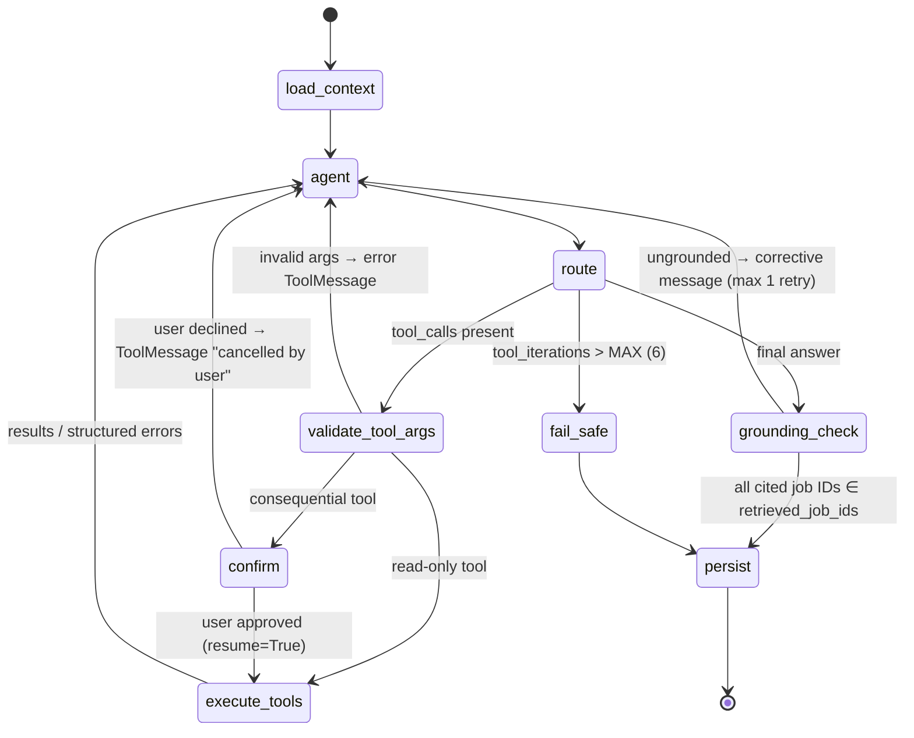

# Agent Architecture

> Status: **Design (Milestone 0)**. Implementation is in Milestone 6. APIs were checked
> against the LangGraph docs (persistence, interrupts) in Nov 2026.

## State

```python
class AgentState(TypedDict):
    messages: Annotated[list[AnyMessage], add_messages]
    candidate_id: str
    candidate_context: CandidateContext | None   # profile + explicit/derived prefs, loaded once per turn
    pending_action: PendingAction | None         # consequential tool call awaiting confirmation
    tool_iterations: int                         # loop guard
    retrieved_job_ids: set[str]                  # every job ID any tool returned this turn (grounding)
```

## Graph



| Node | Responsibility |
|---|---|
| `load_context` | Reads the profile and preferences from Postgres (not from chat history). Ownership is fixed to the authenticated candidate. |
| `agent` | LLM call with tools bound. The system prompt states: only mention jobs returned by tools; never claim an action succeeded without a tool result. |
| `validate_tool_args` | Parses every tool call into its Pydantic input model. A failure becomes a `ToolMessage` describing the error, so the LLM can correct itself. It counts toward the *invalid tool argument rate*. |
| `confirm` | Calls `interrupt({"action": ..., "summary": ...})`. Resume uses `Command(resume=bool)`. Per the docs, the node re-runs from its start on resume, so it performs **no side effects** before the interrupt. |
| `execute_tools` | Runs tools with timeouts and catches **specific** exceptions. Each output is validated against the tool's output model. A tool returns `{ok: false, error_code}` instead of raising. |
| `grounding_check` | Deterministic: extracts job IDs and titles mentioned in the answer and checks them against `retrieved_job_ids` and the DB records. |
| `persist` | Writes user/assistant/tool messages to the `messages` table. |

Checkpointer: `PostgresSaver` (`langgraph-checkpoint-postgres`), with `thread_id = conversation_id`.

## Tools

| Tool | Consequential? | Backed by |
|---|---|---|
| `search_jobs(query, filters, top_k)` | no | retrieval engine |
| `get_job_details(job_id)` | no | jobs repository |
| `rank_jobs(job_ids)` | no | ranking engine |
| `analyze_candidate_profile()` | no | profile + skill-gap computation |
| `explain_job_match(job_id)` | no | ranking feature contributions (not LLM-invented) |
| `get_saved_jobs()` | no | saved_jobs |
| `get_candidate_preferences()` | no | agent_memory |
| `get_application_status(job_id?)` | no | applications |
| `save_job(job_id)` | **yes** → confirm | interactions service |
| `update_candidate_preferences(changes)` | **yes** → confirm | memory service |

Tools take `candidate_id` from graph state, **never** from LLM arguments. This prevents
prompt-injected cross-user access.

## Example: "Find backend jobs in Bangalore with Python and distributed systems, preferably above 15 LPA"
1. `agent` emits `search_jobs(query="backend python distributed systems", filters={location: "Bangalore", salary_min: 1500000, currency: "INR"})`. "Preferably" is a soft constraint, so the agent may instead pass it as a ranking preference. This is a benchmark case.
2. `validate_tool_args` → `execute_tools` → `rank_jobs`, which personalizes and reranks.
3. `explain_job_match` for the top results, then the final answer cites real job IDs.
4. `grounding_check` passes → `persist`.

## Example: "Remember that I prefer backend roles over frontend roles"
`update_candidate_preferences({"role_category": {"prefer": ["backend"], "avoid": ["frontend"]}})`
→ `confirm` (interrupt) → user approves → upsert into `agent_memory` (`explicit_preference`, confidence 1.0) → the tool returns the persisted row → the agent confirms **from the returned row**.
