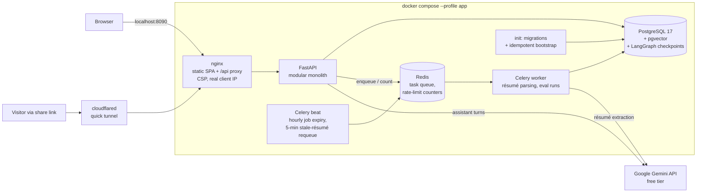
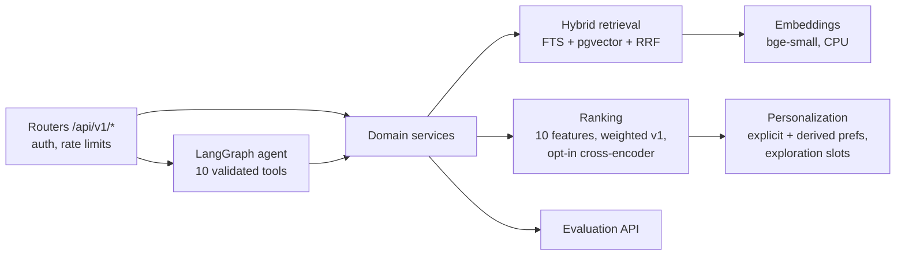
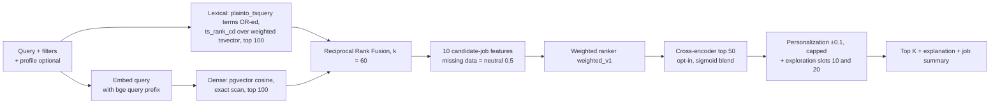

# System Architecture

> Status: **As built (Milestone 10).** This started as the Milestone 0 design. Where the build
> differs from the design, the difference and the reason are stated (look for "Changed from design").

## 1. Design goals

| Goal | What it means concretely |
|---|---|
| LLM-independent core | Retrieval, ranking, personalization and evaluation run and are tested with **no LLM configured**. The assistant and résumé extraction are clients of these systems, not their foundation. |
| Measurable | Every retrieval/ranking change is evaluated against a versioned, labelled dataset; results are stored in `evaluation_runs`. |
| Reproducible | Pinned dependencies (uv lock + a release-date cutoff; exact npm versions), pinned model names, seeded experiments, a migration for every schema change. |
| Understandable | One deployable backend (modular monolith), one database. No infrastructure without a measured need. |
| Honest | Synthetic data is labelled as synthetic. No metric appears in docs unless a script produced it. |

## 2. Runtime architecture



Inside the API process:



**Changed from design:**
- **LLM providers:** only the Gemini adapter is built. The provider interface (`integrations/llm/base.py`) stays, so another adapter is one file. OpenAI/local adapters were cut: unused code is untested code.
- **Redis is a queue and rate-limit store, not a cache.** Search measured 54–63 ms p50 end to end, and the only cacheable piece (query embedding) is ~8 ms. A cache would add invalidation complexity to save single-digit milliseconds ([performance-benchmarks.md](performance-benchmarks.md)).
- **Runs on one machine.** In 2026 free cloud tiers offer ~512 MB RAM and the backend needs 1–2 GB (PyTorch + two models). Sharing goes through a Cloudflare quick tunnel (ADR-014).

### Request-time vs background work

| Runs in the request | Runs in the Celery worker | Run by CLI / `bootstrap` |
|---|---|---|
| Search: query embedding + SQL + ranking (+ cross-encoder if asked) | Résumé PDF → text → Gemini extraction → post-checks | Job import (CSV/JSON/JSONL), deduplication |
| Assistant turn (LLM calls + tools) | Retrieval evaluation runs started from the UI | Embedding new/changed jobs |
| Profile, saved jobs, applications, preferences | Scheduled (beat): job expiry, stale-résumé requeue | Skill taxonomy seed, demo account, benchmarks |

Rule: slow, retryable or LLM-bound work that a user triggers goes to the worker; the API returns
the record and the client polls its `status`. **Changed from design:** imports and embedding stay
CLI jobs because the data set is static and they run once at bootstrap; a worker queue adds
nothing until there is a live job feed.

## 3. Backend layering

Package by domain, with layers inside each domain:

```
router (HTTP: parse/validate, auth, rate limits, status codes)
  └─ service (business logic, transactions; no HTTP)
       └─ repository / ORM queries
```

- Routers pass the session down; services never import FastAPI.
- External providers (LLM, embedding model) sit behind small `Protocol` interfaces in
  `app/integrations/`, so tests use fakes (no test calls a real LLM).
- **Sync endpoints** with sync SQLAlchemy + psycopg 3 (ADR-004): the heavy request-time work is
  CPU-bound, and LangGraph's sync `PostgresSaver` matches.

## 4. Core data flows

### 4.1 Job ingestion
Parse → Pydantic validation (invalid rows recorded with a retryable flag) → normalize (title,
location, salary to annual, skills via the alias table) → content hash → upsert:
same hash = no-op; changed = update; new = near-duplicate check (shingles + Jaccard, with a
lifetime rule) → insert or link as duplicate. Embedding then touches only jobs whose content hash
differs from the stored embedding's ([ingestion.md](ingestion.md)).

### 4.2 Search and recommendations



**Changed from design:** dense retrieval uses an **exact** scan; HNSW was built, measured and
rolled back (saves <1 ms at 1.6k vectors, costs recall). Lexical uses OR-ed `plainto_tsquery`
terms because AND-ing every term returned almost nothing for natural queries.

### 4.3 Assistant turn
See [agent-architecture.md](agent-architecture.md): load profile and memory → the LLM picks tools →
every argument validated with Pydantic → consequential tools (save a job, change a preference) pause
on a LangGraph `interrupt()` until the user confirms → the reply is checked against tool output
(grounding) with one corrective retry.

### 4.4 Résumé
Upload (PDF check, 5 MB, server-generated path) → enqueue → worker extracts text → Gemini structured
extraction → post-processing (drop skills not in the text, negation filter, dictionary-only skills
become suggestions, experience from merged date ranges) → user reviews every field → apply (skills
merged, empty fields never overwrite) ([resume-intelligence.md](resume-intelligence.md)).

## 5. Repository structure (as built)

```
backend/app/
  main.py                 app factory, middleware, routers
  cli.py                  bootstrap, seed-*, ingest/embed, eval-*, bench-performance, make-admin
  demo.py                 demo account (fictional profile)
  core/                   config, errors, security, logging, rate_limit
  db/                     engine/session, base mixins, enums, redis
  api/                    deps (CurrentUser/Admin), health, public stats
  domains/
    auth, candidates, skills, jobs, ingestion
    search/               retrievers (lexical, dense), fusion, indexing, service
    ranking/              features, weighted (+ weights_v1.json), cross_encoder, explain
    personalization/      categories, derived preferences, adjustment
    interactions/         events, saved jobs, applications
    preferences/          the fixed preference vocabulary
    resumes/              pdf_text, prompts, postprocess, service
    agent/                graph, tools, prompts, checkpointer, service
    evaluation/           metrics, retrieval/ranking/personalization/agent/extraction evals, ltr, talentclef
  integrations/           llm (Gemini), embeddings (sentence-transformers)
  worker/                 celery_app, tasks
frontend/src/
  app/ (router, shell)  pages/ (landing, auth, 10 app pages)  features/ (auth, jobs, assistant,
  resume, evaluation)  components/ (brand: terrain, beam, mark; ui: shadcn)  lib/ (api client, types, format)
infra/nginx/              site config + security headers
scripts/share.sh          public link via Cloudflare quick tunnel
data/  eval/  docs/       datasets (synthetic + external), eval sets and reports, documentation
```

## 6. Cross-cutting concerns

| Concern | As built |
|---|---|
| Configuration | `pydantic-settings`; secrets only from env; `.env.example` lists every key. Production mode refuses a default or short JWT secret. |
| Errors | Domain exceptions → one JSON envelope `{error: {code, message, details, request_id}}`; 429 adds `Retry-After`. No stack traces leave the server. |
| Logging | `structlog` (JSON in Docker) with request ID, user ID and latency; Docker logs capped at 3 × 10 MB per service. |
| AuthZ | Every owned record is filtered by the identity from the token, never from the request body; agent tools get identity from auth, not from the LLM. Tested (user A can't read user B). |
| Rate limiting | Redis fixed window: sign-up and sign-in per address; assistant, résumé uploads and search per user. Fails open. |
| Caching | Not built: measured as unnecessary (see §2). Static assets are cached by nginx (hashed files, one year). |
| Health | `/health/live` (process) and `/health/ready` (database + Redis). |
| Security headers | CSP (inline script allowed by hash), `nosniff`, referrer policy, `frame-ancestors 'none'`. See [security.md](security.md). |
