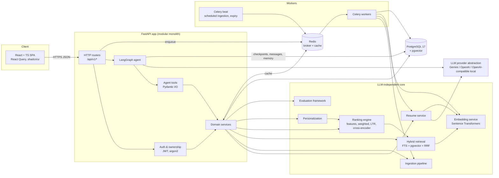
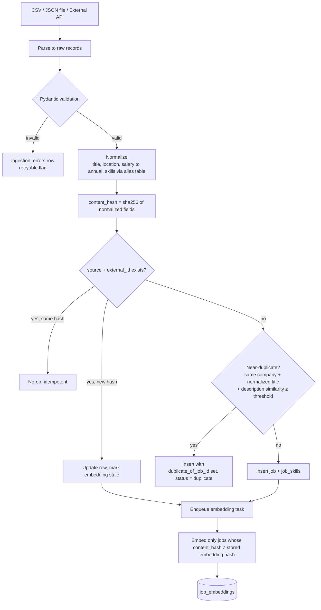
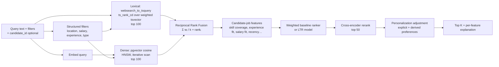

# System Architecture

> Status: **Design (Milestone 0)**. Nothing here is implemented yet. This document
> is updated as each milestone lands, and every section states its implementation status.

## 1. Design goals

| Goal | What it means concretely |
|---|---|
| LLM-independent core | Retrieval, ranking, personalization and evaluation run and are tested with **no LLM configured**. The agent is a client of these systems, not their foundation. |
| Measurable | Every retrieval/ranking change is evaluated against a versioned, labelled dataset; results are stored in `evaluation_runs`. |
| Reproducible | Pinned dependencies, pinned model names, seeded experiments, migrations for every schema change. |
| Understandable | A single deployable backend (modular monolith), not microservices. One database. No infrastructure without a measured need. |
| Honest | Synthetic data is labelled as synthetic. No metric appears in docs unless a script produced it. |

## 2. High-level architecture



### Request-time vs. background work

| Runs in the request | Runs in Celery |
|---|---|
| Search (query embedding + SQL), ranking of top-N, cross-encoder rerank of top-50 | Resume PDF parsing + LLM extraction (seconds, can fail) |
| Agent turn (LLM calls + tools) | Job imports (batches of thousands), deduplication |
| CRUD on profile, saved jobs, applications | Bulk embedding generation, re-embedding when the model changes |
| | Scheduled job expiry, derived-preference recomputation, evaluation runs |

Rule: anything that is slow, retryable, or batch-shaped goes to a worker; the API returns
a task/record ID and the client polls the record's `status` column.

## 3. Backend layering

Package-by-domain, with the same three layers inside each domain:

```
router (HTTP: parse/validate, auth, status codes)
  └─ service (business logic, transactions, no HTTP or SQL details)
       └─ repository (SQLAlchemy queries; the only layer that writes SQL)
```

- Routers never touch the ORM session directly except to pass it down.
- Services never import FastAPI.
- External providers (LLM, embedding model, external job API) sit behind small `Protocol`
  interfaces in `app/integrations/` so they can be swapped and faked in tests.

### Sync vs. async decision

Endpoints are **synchronous by default** (FastAPI runs them in a threadpool) with sync
SQLAlchemy + psycopg 3. Reasons:

1. The heavy request-time work (embedding a query, cross-encoder scoring) is CPU-bound,
   so async gives no benefit and makes it easy to block the event loop by mistake.
2. Sync SQLAlchemy is simpler to reason about and debug, and LangGraph's sync
   `PostgresSaver` matches it.
3. The one place async genuinely helps is **streaming agent responses**. That endpoint can
   be made async (SSE) in Milestone 6 if we measure a need.

See ADR-004 in [engineering-decisions.md](engineering-decisions.md).

## 4. Core data flows

### 4.1 Job ingestion



Incremental by design: unchanged records cost one indexed lookup and nothing else, so
re-running an import of 10k jobs where 50 changed re-embeds 50.

### 4.2 Search and recommendation



Each stage is a separate, swappable function with the same input/output shape, which is
what lets the evaluation framework compare "lexical only" vs "hybrid + cross-encoder +
personalization" on the same dataset.

### 4.3 Agent turn

See [agent-architecture.md](agent-architecture.md) for the state graph. Summary: the agent
loads the candidate's profile and memory, the LLM selects tools, every tool argument is
validated with Pydantic before execution, consequential tools (save job, update
preferences) pause on a LangGraph `interrupt()` for user confirmation, and the final
answer is checked for grounding against the job records actually returned by tools.

## 5. Repository structure (proposed)

```
talent-intelligence-engine/
├── backend/
│   ├── pyproject.toml            # deps pinned, ruff/mypy/pytest config
│   ├── alembic.ini
│   ├── migrations/               # Alembic versions
│   ├── app/
│   │   ├── main.py               # app factory, middleware, router registration
│   │   ├── core/                 # config (pydantic-settings), logging, security, errors
│   │   ├── db/                   # engine, session, Base, shared column types
│   │   ├── domains/
│   │   │   ├── auth/             # router.py, service.py, repository.py, schemas.py, models.py
│   │   │   ├── candidates/
│   │   │   ├── resumes/
│   │   │   ├── skills/
│   │   │   ├── jobs/
│   │   │   ├── ingestion/
│   │   │   ├── search/           # lexical.py, dense.py, fusion.py, retriever.py
│   │   │   ├── ranking/          # features.py, weighted.py, ltr.py, cross_encoder.py
│   │   │   ├── personalization/
│   │   │   ├── interactions/     # saved jobs, applications, interaction events
│   │   │   ├── agent/            # graph.py, state.py, tools/, memory.py, prompts/
│   │   │   └── evaluation/       # metrics.py, runners/, datasets.py
│   │   ├── integrations/         # llm/, embeddings/, job_sources/
│   │   └── workers/              # celery_app.py, tasks/
│   └── tests/
│       ├── unit/                 # pure functions: metrics, RRF, features, normalization
│       ├── integration/          # real Postgres (testcontainers or compose service)
│       └── api/                  # HTTP-level tests with TestClient
├── frontend/
│   ├── src/{app,pages,components,features,lib,api}
│   └── tests/
├── data/
│   ├── synthetic/                # generated job listings — LABELLED SYNTHETIC
│   └── README.md                 # provenance + licence of every dataset
├── eval/
│   ├── datasets/                 # versioned query sets + relevance labels (qrels)
│   ├── labelling-guidelines.md
│   └── reports/                  # generated experiment reports (from scripts only)
├── docs/
├── docker-compose.yml
├── .github/workflows/ci.yml
└── README.md, ROADMAP.md, PROJECT_STATUS.md, TECHNICAL_INTERVIEW_NOTES.md, …
```

## 6. Cross-cutting concerns

| Concern | Approach |
|---|---|
| Configuration | `pydantic-settings`; every secret comes from env; `.env.example` documents all keys. App refuses to start in `production` with default secrets. |
| Errors | Domain exceptions (`NotFound`, `Forbidden`, `Conflict`, `ValidationFailed`, `UpstreamUnavailable`) mapped to one JSON error envelope `{error: {code, message, details, request_id}}`. |
| Logging | `structlog` JSON logs with `request_id`, `user_id`, latency; the request ID is also returned in a response header. |
| AuthZ | Every candidate-owned query is filtered by `candidate_id` derived from the token, never from the request body. Tested explicitly (user A cannot read user B). |
| Pagination | Keyset (cursor) pagination for job lists (stable under inserts); offset only for small admin lists. |
| Rate limiting | Redis-backed fixed-window limiter on auth, search and agent endpoints. |
| Caching | Redis, keys include an index version number so a bulk ingest invalidates all search caches by incrementing one counter. See [performance-benchmarks.md] (Milestone 9). |
| Health | `/health/live` (process up) and `/health/ready` (DB + Redis + model loaded). |
