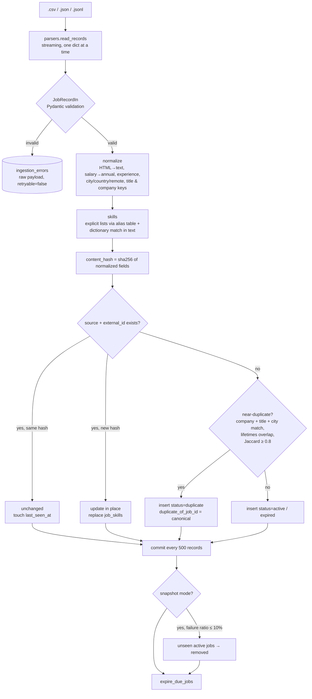

# Job Ingestion Pipeline

> Status: **Implemented (Milestone 2A)**. Code: `backend/app/domains/ingestion/`. Tests:
> `tests/unit/test_normalize.py`, `tests/unit/test_skill_extraction_and_parsing.py`,
> `tests/integration/test_ingestion.py`.

## Data flow



Each record runs inside its own `SAVEPOINT`. A database error on one record rolls back only
that record, which is then logged to `ingestion_errors` with a `retryable` flag.

## Running it
```bash
cd backend
uv run python -m app.cli seed-skills                       # curated taxonomy (idempotent)
uv run python -m app.cli ingest-jobs ../data/synthetic/jobs_v1.jsonl --source synthetic_v1
uv run python -m app.cli ingest-jobs feed.jsonl --source partner_x --mode snapshot
uv run python -m app.cli runs                              # recent runs + counts
uv run python -m app.cli retry-failed <run_id> [--all]
uv run python -m app.cli expire-jobs
```
Milestone 9 wraps these same service functions in Celery tasks with a beat schedule.

## Input contract (`JobRecordIn`)
Required: `external_id`, `title`, `company`, `description` (≥ 20 chars). Optional: `location`,
`location_type`, `employment_type`, salary (structured `salary_min/max/currency/period`
**or** `salary_text`), experience (structured **or** `experience_text`), `required_skills`,
`preferred_skills`, `posted_at`, `expires_at`. CSV list cells use `;` or `|`. Naive timestamps
are treated as UTC. Unknown columns are ignored.

## Key decisions

| Decision | Why | Alternative rejected |
|---|---|---|
| Content hash over **normalized** fields | Whitespace or HTML-only changes don't trigger updates or re-embedding | Hash of the raw record: every cosmetic change looks like a change |
| Unparseable salary/experience becomes `NULL` + warning | Never invent data. Ranking treats unknown as neutral | Best-effort guessing |
| Duplicates are **kept** and linked | Auditable and reversible; retrieval filters `status='active'` | Deleting duplicates loses the evidence |
| Dedup blocking key = normalized company + title + city | Candidate set per record is tiny, so exact Jaccard is cheap | MinHash/LSH: unnecessary at thousands of jobs (revisit at ~10⁶) |
| **Lifetime rule**: candidate must be active, or the new post must predate the candidate's expiry | A repost after expiry is a real new opening | "Active only" missed 18/80 injected duplicates whose originals had since expired (measured, see below) |
| Snapshot safety valve (>10% failures → skip removal) | A truncated or broken file must not wipe the feed | Trusting every snapshot |
| Text skill matching excludes ambiguous skills and common-word aliases | "Go", "R", "rest" and "node" cause false positives in prose | Matching everything |

## Measured on the synthetic dataset (seed 42, 2,084 records)

| Metric | Result |
|---|---|
| First import | 2,000 inserted · 80 duplicates · 4 failed (the 4 injected invalid records) |
| Re-import of the same file | 0 inserted · 0 updated · **2,080 unchanged** |
| Duplicate detection vs injected ground truth | precision 1.000, recall 1.000 (80/80, 0 false positives) |
| Same, before the lifetime rule | precision 1.000, recall 0.775 |
| Wall time per import (laptop, includes process start-up) | ~13–17 s |

**Caveat:** the injected reposts are light template edits, so this is an easy test. Real
reposts with rewritten descriptions would lower recall. The threshold of 0.8 has not been tuned on real data.

## Known limitations
- No negation handling in skill text matching ("no Java needed" still matches Java).
- `expire_due_jobs` and dedup comparisons run per record with simple queries. That's fine for
  thousands of records; for very large feeds, batch prefetching would cut round-trips.
- Cross-currency salary comparison is out of scope.
- The taxonomy is hand-written (138 skills, 92 aliases). Skills outside it are created
  uncategorized and are not used for text matching.
