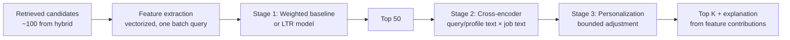

# Ranking & Personalization Engine

> Status: **Design (Milestone 0)**. Implementation is in Milestones 4 (ranking) and 5 (personalization).

## Pipeline



## Features (all in [0, 1], all deterministic)

| Feature | Definition |
|---|---|
| `required_skill_coverage` | \|candidate ∩ job.required\| / \|job.required\| |
| `preferred_skill_coverage` | same, over `importance = preferred` |
| `skill_jaccard` | \|C ∩ J\| / \|C ∪ J\| |
| `semantic_similarity` | cosine(candidate_emb, job_emb) |
| `retrieval_score` | normalized fused RRF score |
| `experience_fit` | 1 inside [min, max]; decays linearly with years outside; 0.5 if unknown |
| `salary_fit` | overlap of the candidate's preferred range and the job's range, same currency only; 0.5 if unknown |
| `location_fit` | 1 exact city / remote-ok; 0.5 same country; 0 otherwise |
| `employment_type_match` | 1 / 0 / 0.5 if unknown |
| `recency` | exp(−age_days / τ), τ = 30 |

"Unknown → 0.5" is explicit so that missing data is neither rewarded nor punished. The
missing-value count is itself logged, because it is an important failure mode to inspect.

## Stage 1: Weighted baseline
`score = Σ wᵢ · fᵢ`, with weights in a versioned config file. Being transparent is the
point: the explanation "ranked #1 because required skill coverage 0.83 (5/6)" falls
directly out of `wᵢ · fᵢ`. The weights are initially hand-set, then tuned by grid search on
the dev split (documented as such).

## Learning-to-rank (gated, see ADR-011)
LightGBM `LGBMRanker(objective="lambdarank")`, grouped by query, on the same features.
It is compared to the weighted baseline on the held-out test split. If it does not beat
the baseline outside noise (paired bootstrap over queries), we report that and keep the baseline.

## Stage 2: Cross-encoder
The input pair is (query text, or a generated profile summary when there is no query;
job title + skills + description head). Its score replaces or blends with the stage-1
score (both variants are evaluated). Latency is measured per request.

## Stage 3: Personalization
```
final = base_score + α · Σ_p  confidence_p · match(job, p)       |adjustment| ≤ cap
```
- **Explicit preferences** (from the agent or settings page): confidence 1.0, e.g. "prefer backend over frontend" → a boost on jobs whose title or skills fall in the backend category.
- **Derived preferences** (Celery job over `job_interactions`):
  - Signal weights: apply > save > click; dismiss is negative; unsave is weakly negative.
  - **Clicks are not treated as positive unless followed by dwell or save/apply.** A click followed by a dismiss is negative.
  - Impressions provide the denominator; non-clicks at low positions are not counted as negatives.
  - Time decay on old events; minimum support (e.g. ≥ 3 events) before a derived preference is created; confidence grows with support.
- **Cold start**: a candidate with no interactions gets α_derived = 0 and only explicit and profile features. A new job has no interaction features at all; ranking uses content features only, so there is no popularity bias against it.
- The adjustment is **capped** so personalization reorders within relevance rather than overriding it.

**Evaluation honesty.** We have no real users. The personalization experiment uses
*scripted* interaction histories generated from a written persona spec (for example,
"backend-leaning persona saves Python/Go roles, dismisses frontend"). It is evaluated on
held-out labels for that persona. That shows the *mechanism* works as designed. It is
**not** evidence of improved real-world engagement, and reports say so.
