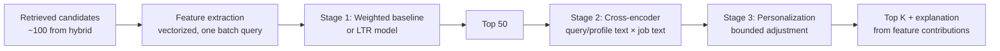

# Ranking & Personalization Engine

> Status: **Ranking implemented (Milestone 4A)**: `backend/app/domains/ranking/` (features, weighted
> ranker, cross-encoder stage, explanations), `POST /api/v1/jobs/search` (`ranking` option) and
> `GET /api/v1/recommendations`. Evaluation on TalentCLEF is Milestone 4B; personalization is Milestone 5.

## Implementation notes (4A)

| Decision | Detail |
|---|---|
| Missing data | Feature = 0.5 (neutral) and listed in `missing_features`; the explanation says "not enough information". |
| "Required" skills | Explicit required list if the posting has one; otherwise skills mentioned in the text stand in (about 30% of postings have no list). |
| Experience | Inside range → 1; under the minimum decays to 0 over 3 years; over-qualified decays over 10 years (gentler). |
| Salary | Only compared in the same currency; job max ≥ candidate minimum → 1, otherwise the ratio. |
| Location | Remote job → 1 (0.8 if the candidate prefers onsite); remote-seeker vs onsite job → 0.2; same city → 1; different city → 0. |
| Weights | `weights_v1.json`, hand-set, sum to 1. Version string returned with every response. |
| Cross-encoder | Top 50 only; `final = 0.5·stage1 + 0.5·sigmoid(logit)`. **Min-max normalisation was tried first and rejected** after a live run: logits for near-identical postings (6.37–6.62) were stretched to [0, 1], and all top-5 results ended up in the wrong city. |
| Latency (laptop CPU, live) | stage 1 ≈ 20–35 ms for 100 jobs; cross-encoder ≈ 0.4–0.6 s for 50 pairs (first call also loads the model, ≈ 8 s). |
| Explanations | Built only from computed features ("Matches 2 of 3 required skills (PostgreSQL, Python)", "Missing: REST APIs", "Biggest factor: …"). No LLM. |

## Evaluation on real human labels (Milestone 4B)

Command: `uv run python -m scripts.fetch_talentclef && uv run python -m app.cli eval-ranking`.
Report: [eval/reports/2026-11-17-talentclef2026_taskA_dev_en.md](../eval/reports/2026-11-17-talentclef2026_taskA_dev_en.md).
Data: TalentCLEF 2026 Task A dev (EN), 10 job queries × 472 **synthetic CVs**, **human expert**
binary labels, CC BY 4.0. Direction: job → candidates (features are symmetric).

| Configuration | NDCG@10 | MAP@100 | Δ MAP vs hybrid [95% CI] |
|---|---|---|---|
| lexical (FTS) | 0.761 | 0.529 | −0.212 [−0.263, −0.161] ✱ |
| dense (bge-small) | 0.969 | 0.777 | +0.036 [−0.004, +0.088] |
| hybrid (RRF k=60) | 0.926 | 0.741 | (baseline) |
| hybrid + features (weighted_v1) | 0.918 | 0.782 | +0.040 [+0.030, +0.052] ✱ |
| hybrid + features + cross-encoder | 0.950 | **0.808** | **+0.067 [+0.038, +0.106] ✱** |
| LambdaMART LOQO (exploratory) | 0.943 | 0.790 | +0.048 [+0.022, +0.088] ✱ |

**Supported by the data:**
1. Lexical is clearly worst. With a whole job description as the query, OR-matching every term is noisy.
2. Feature ranking improves the ranking *beyond* the top 10 (MAP), not the top 10 itself (NDCG@10 −0.007, n.s.).
3. **The cross-encoder helps on real data** (best MAP, significant). This is the opposite of the
   worry that a web-trained model wouldn't transfer. It costs ≈0.5 s, so it stays an opt-in stage.

**Suggested, not acted on:**
4. Dense alone beats hybrid at the top (NDCG@10 +0.044, CI touches 0), driven by one query
   (q9: lexical 0.29). Lowering the lexical weight for long queries is a hypothesis. We did
   **not** tune it on these 10 queries: with no held-out split, that would be fitting the test set.

**Caveats:** 10 queries; only skill coverage, semantic similarity and retrieval score vary here
(salary, location, job type and recency are absent; no job states a "N years" requirement, so
experience is neutral). Long-phrase "skills" (e.g. the HVAC job) never match CV text verbatim. That
is left as a documented limitation rather than tuned on labelled data. LambdaMART stays
exploratory (ADR-011: < 50 queries).

## Pipeline



## Features (all in [0, 1], all deterministic)

| Feature | Definition |
|---|---|
| `required_skill_coverage` | \|candidate ∩ job.required\| / \|job.required\| |
| `preferred_skill_coverage` | same, over `importance = preferred` |
| `skill_jaccard` | \|C ∩ J\| / \|C ∪ J\| |
| `semantic_similarity` | cosine(candidate_emb, job_emb) |
| `retrieval_score` | normalized fused RRF score |
| `experience_fit` | 1 inside [min, max]; decays linearly with years outside; 0.5 if unknown |
| `salary_fit` | overlap of the candidate's preferred range and the job's range, same currency only; 0.5 if unknown |
| `location_fit` | 1 exact city / remote-ok; 0.5 same country; 0 otherwise |
| `employment_type_match` | 1 / 0 / 0.5 if unknown |
| `recency` | exp(−age_days / τ), τ = 30 |

"Unknown → 0.5" is explicit so that missing data is neither rewarded nor punished. The
missing-value count is itself logged, because it is an important failure mode to inspect.

## Stage 1: Weighted baseline
`score = Σ wᵢ · fᵢ`, with weights in a versioned config file. Being transparent is the
point: the explanation "ranked #1 because required skill coverage 0.83 (5/6)" falls
directly out of `wᵢ · fᵢ`. The weights are initially hand-set, then tuned by grid search on
the dev split (documented as such).

## Learning-to-rank (gated, see ADR-011)
LightGBM `LGBMRanker(objective="lambdarank")`, grouped by query, on the same features.
It is compared to the weighted baseline on the held-out test split. If it does not beat
the baseline outside noise (paired bootstrap over queries), we report that and keep the baseline.

## Stage 2: Cross-encoder
The input pair is (query text, or a generated profile summary when there is no query;
job title + skills + description head). Its score replaces or blends with the stage-1
score (both variants are evaluated). Latency is measured per request.

## Stage 3: Personalization
```
final = base_score + α · Σ_p  confidence_p · match(job, p)       |adjustment| ≤ cap
```
- **Explicit preferences** (from the agent or settings page): confidence 1.0, e.g. "prefer backend over frontend" → a boost on jobs whose title or skills fall in the backend category.
- **Derived preferences** (Celery job over `job_interactions`):
  - Signal weights: apply > save > click; dismiss is negative; unsave is weakly negative.
  - **Clicks are not treated as positive unless followed by dwell or save/apply.** A click followed by a dismiss is negative.
  - Impressions provide the denominator; non-clicks at low positions are not counted as negatives.
  - Time decay on old events; minimum support (e.g. ≥ 3 events) before a derived preference is created; confidence grows with support.
- **Cold start**: a candidate with no interactions gets α_derived = 0 and only explicit and profile features. A new job has no interaction features at all; ranking uses content features only, so there is no popularity bias against it.
- The adjustment is **capped** so personalization reorders within relevance rather than overriding it.

**Evaluation honesty.** We have no real users. The personalization experiment uses
*scripted* interaction histories generated from a written persona spec (for example,
"backend-leaning persona saves Python/Go roles, dismisses frontend"). It is evaluated on
held-out labels for that persona. That shows the *mechanism* works as designed. It is
**not** evidence of improved real-world engagement, and reports say so.
