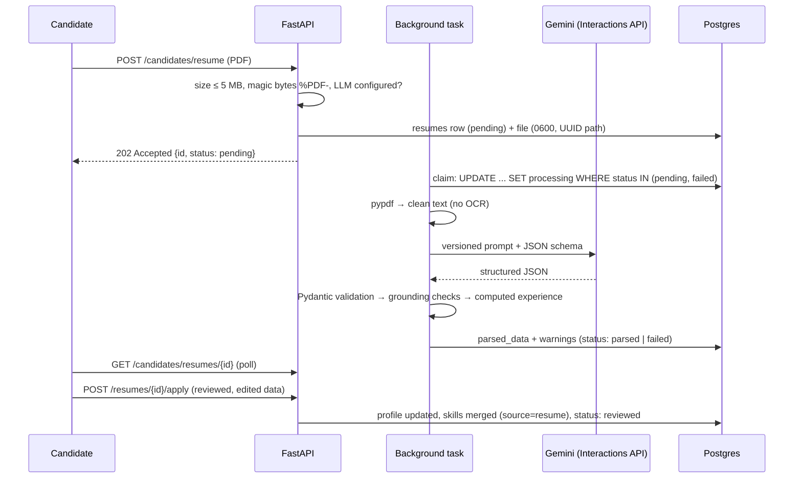

# Resume Intelligence

> Status: **Implemented (Milestone 2B)**. Code: `backend/app/domains/resumes/`,
> `backend/app/integrations/llm/`. Verified end-to-end against live Gemini on 2026-11-17.

## Flow

## How "never invent candidate experience" is enforced

The LLM is used for **reading**, not for **judging**. Every number and every kept fact passes a
deterministic check:

| Risk | Control | Test |
|---|---|---|
| LLM adds a skill not in the resume | Skill kept only if it, or one of its aliases, appears in the text; otherwise dropped with a warning | `test_hallucinated_skill_is_removed_with_warning`, API test with "Kubernetes" |
| LLM "estimates" years of experience | `experience_years` is **computed** from the extracted date ranges (overlaps merged); the prompt forbids totals; undated roles are excluded and reported | `test_experience_*`, `test_experience_years_never_comes_from_llm_text` |
| LLM invents a name/location | Dropped if not present in the text | `test_name_not_in_text_is_dropped_not_invented` |
| LLM invents an employer | Entry kept but flagged `grounded=false` for the reviewer | `test_work_entries_are_flagged_when_unverifiable` |
| Extraction silently overwrites the profile | Nothing is applied until the candidate calls `/apply` with the data they reviewed; skills are **merged**, never deleted | `test_nothing_reaches_the_profile_until_applied` |
| Resume text contains instructions ("ignore the rules…") | Text is fenced as data, the end marker is neutralised, output is schema-constrained, and every fact is still grounding-checked | `test_prompt_cannot_be_closed_early_by_resume_content` |

A dictionary matcher (the same one as job ingestion) runs on the text independently. Each
skill records its provenance: `llm`, `dictionary` or `both`. **Since Milestone 7, dictionary-only skills are
`suggested=true`**: shown for review but not pre-selected. A **negation filter** drops a skill whose every
mention follows "no / not / never / without / lacking …". Both changes came from the extraction benchmark
(docs/evaluation-framework.md), where the dictionary re-added a prompt-injected skill.

## Failure handling

| Situation | Result |
|---|---|
| No LLM configured | `503 upstream_unavailable` **before** anything is stored |
| Not a PDF / > 5 MB | `415` / `413` |
| Encrypted, corrupted, image-only (scanned) PDF | status `failed` with a readable reason; LLM not called |
| LLM 429/5xx/timeout | 3 attempts with 1 s / 2 s backoff, then `failed`: "temporarily unavailable"; `/reprocess` retries |
| LLM returns invalid JSON or schema mismatch | `failed`; raw text never stored in the profile |
| Two workers processing the same resume | Atomic claim (`UPDATE … WHERE status IN (…) RETURNING`): only one proceeds |

## Provider decision (see ADR-008)

- **Model:** `gemini-3.5-flash-lite` (configurable `LLM_MODEL`). Measured on 2026-11-17 with a
  fictional one-page resume: ~7 s end-to-end extraction. `gemini-3.8-flash` hit the server's
  600 s deadline on the free tier during testing, so it is not the default.
- **Endpoint:** the REST Interactions API (`POST /v1beta/interactions`, header
  `Api-Revision: 2026-05-20`). `generateContent` returned 404 for current free-tier models.
- **Schema adaptation:** `$defs` inlined, `anyOf[X, null]` → `type: [X, "null"]`, metadata
  `title` removed. A first version also removed a *field* called `title`, and the API rejected the schema with
  400; a regression test now covers it.
- **Privacy:** on the free tier Google may use prompts to improve its products. Only fictional
  resumes or your own should be uploaded while on the free tier. Contact details (email/phone)
  are deliberately **not** in the extraction schema.

## Limitations
- No OCR: scanned resumes fail with a clear message.
- Grounding is lexical. A skill written as "golang" is matched through the alias table, but
  paraphrases ("built containers") aren't recognised as "Docker".
- Short ambiguous skills returned by the LLM (e.g. "Go") can be grounded by an unrelated word.
- Background work uses FastAPI `BackgroundTasks` (lost on restart). It moves to Celery in Milestone 9.
- Extraction quality has **not yet been measured** on a labelled set. That is Milestone 7
  (JSON validity, schema compliance, per-field precision/recall, hallucinated-field rate).
